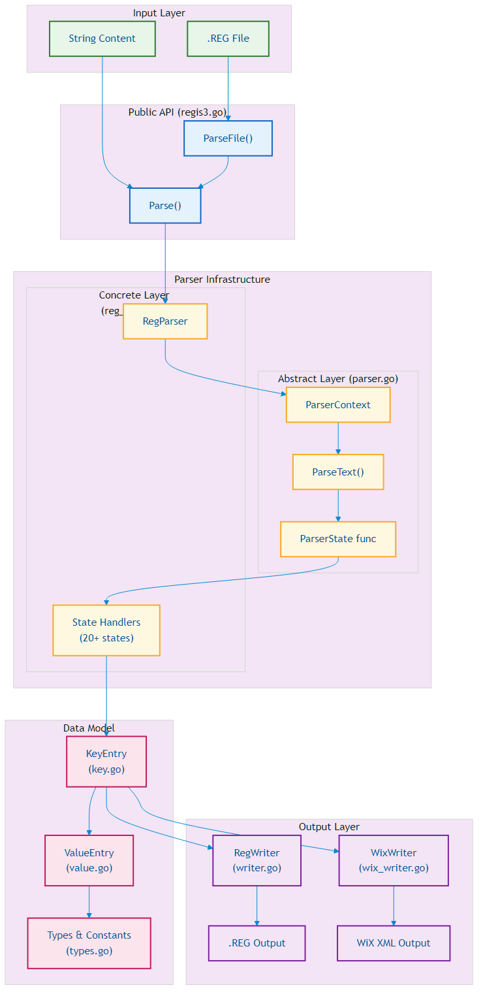

# go-regis3 Code Documentation

This document provides a comprehensive technical overview of the go-regis3 library, starting with essential background on Windows Registry files, followed by architectural decisions and deep dives into the parser implementation.

## Table of Contents

1. [Understanding .REG Files](#understanding-reg-files)
2. [Architecture Overview](#architecture-overview)
3. [The Abstract Parser (parser.go)](#the-abstract-parser-parsergo)
4. [The REG Parser (reg_parser.go)](#the-reg-parser-reg_parsergo)
5. [Data Model](#data-model)
6. [Writers](#writers)
7. [Stylistic Differences Between Implementations](#stylistic-differences-between-implementations)

---

## Understanding .REG Files

### What Are .REG Files?

`.REG` files are plain-text configuration files used by Windows to import and export registry data. They serve as a portable, human-readable representation of registry keys and values. When double-clicked or imported via `regedit.exe`, they modify the Windows Registry.

A minimal .REG file looks like this:

```reg
Windows Registry Editor Version 5.00

[HKEY_CURRENT_USER\Software\Example]
"StringValue"="Hello World"
"DwordValue"=dword:00000001
```

### REGEDIT4 vs. Windows Registry Editor Version 5.00

There are two distinct .REG file formats, distinguished by their header line:

| Aspect | REGEDIT4 | Windows Registry Editor Version 5.00 |
|--------|----------|--------------------------------------|
| **Header** | `REGEDIT4` | `Windows Registry Editor Version 5.00` |
| **Encoding** | ANSI (Windows-1252) | UTF-16LE with BOM |
| **Origin** | Windows 9x/NT4 | Windows 2000+ |
| **Unicode Support** | Limited | Full |
| **Line Endings** | CR+LF | CR+LF |

**Critical Distinction**: The encoding difference has real implications:

- **REGEDIT4**: Uses ANSI encoding. Non-ASCII characters are limited to the local code page. If you export a registry key containing Japanese characters on an English system, data may be lost or corrupted.

- **Windows Registry Editor 5.00**: Uses UTF-16LE encoding (preceded by a BOM: `FF FE`). Fully supports all Unicode characters, making it the preferred format for modern use.

go-regis3 handles both formats transparently:
- On **parse**: Auto-detects the header and encoding (UTF-16LE BOM triggers automatic conversion)
- On **export**: Caller chooses format via the `RegWriter` constructor

### .REG File Syntax Reference

#### Key Declarations

Keys are declared in square brackets:

```reg
[HKEY_LOCAL_MACHINE\SOFTWARE\MyApp]
```

Nested brackets are allowed (rare but valid):

```reg
[HKEY_LOCAL_MACHINE\SOFTWARE\My[Weird]App]
```

Key deletion uses a minus prefix:

```reg
[-HKEY_LOCAL_MACHINE\SOFTWARE\MyApp]
```

#### Value Declarations

Values follow the pattern `"name"=type:data` or `@=type:data` for the default value:

| Type | Syntax | Example |
|------|--------|---------|
| REG_SZ | `"name"="value"` | `"Path"="C:\\Windows"` |
| REG_DWORD | `"name"=dword:XXXXXXXX` | `"Count"=dword:0000000a` |
| REG_BINARY | `"name"=hex:XX,XX,...` | `"Data"=hex:01,02,03` |
| REG_EXPAND_SZ | `"name"=hex(2):XX,XX,...` | Environment variable strings |
| REG_MULTI_SZ | `"name"=hex(7):XX,XX,...` | Multi-string lists |
| REG_QWORD | `"name"=hex(b):XX,XX,...` | 64-bit integers |

Value deletion:

```reg
"ValueName"=-
```

#### Line Continuation

Long binary values use backslash continuation:

```reg
"LongBinary"=hex:01,02,03,04,05,06,07,08,09,0a,0b,0c,0d,0e,0f,10,\
  11,12,13,14,15,16,17,18,19,1a,1b,1c,1d,1e,1f,20
```

---

## Architecture Overview



### Package Structure

go-regis3 is a single-package library with no external dependencies. The files are organized by responsibility:

| File | Responsibility |
|------|----------------|
| `regis3.go` | Public API entry points |
| `parser.go` | Abstract state machine infrastructure |
| `reg_parser.go` | .REG-specific parser implementation |
| `types.go` | Registry type constants and option structs |
| `errors.go` | Custom `ParseError` type with location info |
| `key.go` | `KeyEntry` - registry key tree nodes |
| `value.go` | `ValueEntry` - registry values |
| `writer.go` | .REG file exporter |
| `wix_writer.go` | WiX XML exporter |
| `wow.go` | WOW64 detection helpers |

### Data Flow

The library follows a clear pipeline:

```
Input (.REG) --> Parse --> KeyEntry Tree --> Manipulate --> Export (.REG or WiX)
```

1. **Parse Phase**: Text is consumed character-by-character by the state machine, building a `KeyEntry` tree
2. **Manipulation Phase**: Users navigate and modify the tree via `KeyEntry`/`ValueEntry` methods
3. **Export Phase**: Writers traverse the tree to produce output

---

## The Abstract Parser (parser.go)

### Design Philosophy

The `ParserContext` in `parser.go` implements a **character-at-a-time state machine parser**. This design was chosen for several reasons:

1. **Predictable Memory Usage**: No look-ahead buffer accumulation; each character is processed exactly once
2. **Fine-Grained Error Reporting**: Line/column tracking is trivial when you process one character at a time
3. **Portability**: This pattern originated in the C# sibling project (`regdiff`), was ported to C++ (`pnq::regis3`), and then to Go
4. **Testability**: Each state handler is an isolated, testable unit

### The State Machine Pattern

The core abstraction is the `ParserState` type:

```go
type ParserState func(r rune) (ParserState, error)
```

Each state handler:
- Receives the current character
- Optionally accumulates it to a buffer
- Returns the **next state** (which may be itself for looping)
- May return an error to abort parsing

This creates a **self-describing state graph** where transitions are explicit in the return values.

### ParserContext Structure

```go
type ParserContext struct {
    Line   int       // Current line number (1-based)
    Column int       // Current column number (1-based)
    Index  int       // Absolute character index
    Buffer []rune    // Accumulator for building tokens

    input    []rune  // Input text as runes
    inputLen int     // Length of input
    pos      int     // Current position in input
}
```

Key methods:

| Method | Purpose |
|--------|---------|
| `ParseText(text, initialState)` | Main parsing loop |
| `BufferAppend(r)` | Add character to accumulator |
| `BufferAsString()` | Get accumulated token |
| `BufferClear()` | Reset accumulator |
| `FormatError(err)` | Augment error with context |

### The Parsing Loop

The `ParseText` method is deceptively simple:

```go
func (p *ParserContext) ParseText(text string, initialState ParserState) error {
    p.input = []rune(text)
    // ... initialization ...

    state := initialState

    for p.pos < p.inputLen {
        r := p.input[p.pos]

        state, err = state(r)  // Call current state with character
        if err != nil {
            return p.FormatError(err)
        }

        // Update position tracking
        if r == '\n' {
            p.Line++
            p.Column = 0
        }
        p.Column++
        p.Index++
        p.pos++
    }
    return nil
}
```

The elegance lies in what's **not** here:
- No switch statements on state enum values
- No explicit state transition tables
- No tokenizer/lexer split

### Reusing ParserContext for Other Formats

The `ParserContext` is format-agnostic. To parse a different format (e.g., INI files), you would:

1. **Embed ParserContext** in your parser struct:

```go
type IniParser struct {
    *ParserContext
    sections map[string]map[string]string
    currentSection string
}
```

2. **Define state handlers** as methods:

```go
func (p *IniParser) stateExpectLineStart(r rune) (ParserState, error) {
    switch r {
    case '[':
        p.BufferClear()
        return p.stateExpectSectionName, nil
    case ';', '#':
        return p.stateSkipComment, nil
    case '\r', '\n':
        return p.stateExpectLineStart, nil  // blank line
    default:
        p.BufferClear()
        p.BufferAppend(r)
        return p.stateExpectKey, nil
    }
}

func (p *IniParser) stateExpectSectionName(r rune) (ParserState, error) {
    if r == ']' {
        p.currentSection = p.BufferAsString()
        return p.stateExpectLineEnd, nil
    }
    p.BufferAppend(r)
    return p.stateExpectSectionName, nil
}
// ... more states ...
```

3. **Wire it up**:

```go
func (p *IniParser) Parse(content string) error {
    return p.ParseText(content, p.stateExpectLineStart)
}
```

The pattern scales well because each state handler is self-contained and the transitions are explicit in the return values.

---

## The REG Parser (reg_parser.go)

### Structure

`RegParser` embeds `ParserContext` and adds .REG-specific state:

```go
type RegParser struct {
    *ParserContext

    options          *ParseOptions   // Parsing options (nil for defaults)
    expectedHeader   string          // "REGEDIT4" or "Windows Registry Editor Version 5.00"
    bracketsExpected int             // For nested bracket tracking
    result           *KeyEntry       // Root of parsed tree
    currentKey       *KeyEntry       // Key being populated
    currentValue     *ValueEntry     // Value being populated
    currentDataKind  uint32          // Type of current binary value
}
```

### State Handler Inventory

The parser has 20+ state handlers, organized by parsing phase:

**Header Phase:**
- `stateExpectHeader` - Validates file header

**Line Structure:**
- `stateExpectStartOfLine` - Dispatches based on first character
- `stateExpectNewline` - Consumes CR/LF sequences
- `stateExpectCarriageReturn` - Handles trailing whitespace

**Key Parsing:**
- `stateExpectKeyPath` - Accumulates key path, handles nested brackets

**Value Parsing:**
- `stateExpectValueNameDefinition` - Parses `"name"`
- `stateExpectQuotedCharInValueName` - Handles escape sequences
- `stateExpectEqualSign` - Awaits `=` or `-`
- `stateExpectStartOfValueDefinition` - Dispatches by value type

**Type-Specific Parsing:**
- `stateExpectStringValueDefinition` - REG_SZ strings
- `stateExpectQuotedCharInStringValue` - String escapes
- `stateExpectHexIntegerValue` - DWORD parsing
- `stateExpectStartOfMultibyteValue` - Binary/hex types
- `stateExpectMultibyteValueDefinition` - Hex byte sequences
- `stateExpectNewlineFollowedByMultibyte` - Line continuation

**Extension States:**
- `stateExpectVariableDefinedHexValue` - `$$VAR$$` syntax
- `stateExpectCommentUntilEndOfLine` - Comment handling

### State Transition Example

Let's trace parsing this line:

```reg
"Count"=dword:00000005
```

```
Character    State                              Action
---------    -----                              ------
"            stateExpectStartOfLine          -> stateExpectValueNameDefinition
C            stateExpectValueNameDefinition  -> (buffer "C")
o            stateExpectValueNameDefinition  -> (buffer "Co")
u            stateExpectValueNameDefinition  -> (buffer "Cou")
n            stateExpectValueNameDefinition  -> (buffer "Coun")
t            stateExpectValueNameDefinition  -> (buffer "Count")
"            stateExpectValueNameDefinition  -> stateExpectEqualSign
                                                (create ValueEntry "Count")
=            stateExpectEqualSign            -> stateExpectStartOfValueDefinition
d            stateExpectStartOfValueDefinition -> (buffer "d")
w            stateExpectStartOfValueDefinition -> (buffer "dw")
o            stateExpectStartOfValueDefinition -> (buffer "dwo")
r            stateExpectStartOfValueDefinition -> (buffer "dwor")
d            stateExpectStartOfValueDefinition -> (buffer "dword")
:            stateExpectStartOfValueDefinition -> stateExpectHexIntegerValue
                                                 (recognized "dword:" prefix)
0            stateExpectHexIntegerValue      -> (buffer "0")
0            stateExpectHexIntegerValue      -> (buffer "00")
0            stateExpectHexIntegerValue      -> (buffer "000")
0            stateExpectHexIntegerValue      -> (buffer "0000")
0            stateExpectHexIntegerValue      -> (buffer "00000")
0            stateExpectHexIntegerValue      -> (buffer "000000")
0            stateExpectHexIntegerValue      -> (buffer "0000000")
5            stateExpectHexIntegerValue      -> (buffer "00000005")
\r           stateExpectHexIntegerValue      -> stateExpectNewline
                                                (parse hex, set DWORD value)
\n           stateExpectNewline              -> stateExpectStartOfLine
```

### Value Type Detection

The `stateExpectStartOfValueDefinition` handler performs type detection:

```go
func (p *RegParser) stateExpectStartOfValueDefinition(r rune) (ParserState, error) {
    if r == '"' {
        // String value: "name"="value"
        return p.stateExpectStringValueDefinition, nil
    } else if r == '-' {
        // Value deletion: "name"=-
        p.currentValue.SetRemoveFlag(true)
        return p.stateExpectCarriageReturn, nil
    } else if r == ':' {
        // Type prefix completed
        typeName := strings.ToLower(p.BufferAsString())

        if typeName == "dword" {
            return p.stateExpectHexIntegerValue, nil
        } else if strings.HasPrefix(typeName, "hex(") {
            // Extract type number from hex(N)
            // ...
            return p.stateExpectStartOfMultibyteValue, nil
        } else if typeName == "hex" {
            return p.stateExpectStartOfMultibyteValue, nil
        }
    }
    // Accumulate type prefix
    p.BufferAppend(r)
    return p.stateExpectStartOfValueDefinition, nil
}
```

### Cleanup Phase

After parsing completes, `cleanup()` unwraps single-child root nodes:

```go
func (p *RegParser) cleanup() {
    if p.result != nil &&
        len(p.result.subKeys) == 1 &&
        len(p.result.values) == 0 &&
        p.result.defaultValue == nil {

        for _, v := range p.result.subKeys {
            p.result = v
            break
        }
        p.result.parent = nil
    }
}
```

This ensures that a file containing only `[HKEY_LOCAL_MACHINE\SOFTWARE\Foo]` returns the `HKEY_LOCAL_MACHINE` node directly, not an empty unnamed root with one child.

---

## Data Model

### KeyEntry (key.go)

`KeyEntry` represents a registry key as a tree node:

```go
type KeyEntry struct {
    parent       *KeyEntry
    name         string
    subKeys      map[string]*KeyEntry   // lowercase key -> entry
    values       map[string]*ValueEntry // lowercase name -> entry
    defaultValue *ValueEntry
    removeFlag   bool
}
```

**Case Insensitivity**: Windows Registry is case-insensitive but case-preserving. go-regis3 mirrors this:
- The `name` field preserves original casing
- Map lookups use `strings.ToLower(name)` as the key

### ValueEntry (value.go)

`ValueEntry` stores a registry value:

```go
type ValueEntry struct {
    name       string   // Original name (empty = default value)
    kind       uint32   // Registry type (RegSz, RegDword, etc.)
    data       []byte   // Raw UTF-16LE bytes for strings, native bytes otherwise
    removeFlag bool     // True if value should be deleted
}
```

**UTF-16LE Internal Storage**: String values are stored as UTF-16LE bytes internally. This ensures:
- Byte-for-byte round-trip fidelity
- No encoding surprises when exporting
- Natural handling of embedded NULLs (theoretically possible in REG_MULTI_SZ)

---

## Writers

### RegWriter (writer.go)

Exports `KeyEntry` trees back to .REG format:

```go
writer := NewRegWriter(HeaderWindows5, ExportOptions{}, true)  // UTF-16LE
writer.Write(file, rootKey)
```

Key behaviors:
- Outputs values in alphabetical order (deterministic output)
- Line-wraps long binary values at column 75
- Handles both ANSI and UTF-16LE encoding

### WixWriter (wix_writer.go)

Exports to WiX 4.x XML format for MSI authoring:

```go
writer := NewWixWriter()
writer.Write(file, rootKey)
```

Two-pass output:
1. **Removal pass**: Flat `<RemoveRegistryKey>` and `<RemoveRegistryValue>` elements
2. **Addition pass**: Nested `<RegistryKey>` hierarchy

---

## Stylistic Differences Between Implementations

go-regis3 is the third implementation of this library, following C# (regdiff) and C++ (pnq::regis3). While all three share the same design philosophy and produce compatible output, they differ in language-idiomatic ways:

### Error Handling

| Language | Approach |
|----------|----------|
| **C#** | Throws exceptions with message strings |
| **C++** | Returns error codes or throws `std::runtime_error` |
| **Go** | Returns `error` interface; `ParseError` struct provides line/column/context |

Go's `ParseError` type allows callers to inspect error details programmatically:

```go
if pe := regis3.IsParseError(err); pe != nil {
    fmt.Printf("Error at line %d, col %d: %s\n", pe.Line, pe.Column, pe.Message)
    fmt.Printf(">> %s\n", pe.Context)
    fmt.Printf(">> %s\n", pe.ContextPointer)
}
```

### Options

| Language | Approach |
|----------|----------|
| **C#** | `[Flags] enum ImportOptions` with bitwise OR |
| **C++** | Bit flags combined with `|` operator |
| **Go** | Struct with bool fields (`ParseOptions`, `ExportOptions`) |

Go's struct approach is more explicit and self-documenting:

```go
// C# / C++: ImportOptions.AllowHashtagComments | ImportOptions.IgnoreWhitespaces
// Go:
opts := &ParseOptions{
    AllowHashtagComments: true,
    IgnoreWhitespaces:    true,
}
```

### Map Exposure

| Language | Approach |
|----------|----------|
| **C#** | `public readonly Dictionary<string, T>` - mutable contents |
| **C++** | `const std::map<string, T>&` - immutable reference |
| **Go** | Returns `map[string]*T` directly - mutable (matches C#) |

go-regis3 matches the C# behavior, exposing mutable maps via `SubKeys()` and `Values()`. This was a deliberate choice for importer compatibility - code that modifies registry trees often needs direct map access. The trade-off is that callers can mutate internal state; this matches C# semantics.

### Helper Functions vs. Methods

| Language | Approach |
|----------|----------|
| **C#** | Static methods on classes (`Wow.Is64BitOperatingSystem()`) |
| **C++** | Namespace functions (`pnq::wow::is_64bit_os()`) |
| **Go** | Package-level functions (`Is64BitOperatingSystem()`) |

Go has no static methods, so WOW64 helpers are package functions rather than methods on a struct:

```go
// C#:  Wow.Is64BitOperatingSystem()
// C++: pnq::wow::is_64bit_os()
// Go:  regis3.Is64BitOperatingSystem()
```

### Naming Conventions

| Aspect | C# | C++ | Go |
|--------|-----|-----|-----|
| **Types** | `PascalCase` | `snake_case` | `PascalCase` |
| **Methods** | `PascalCase` | `snake_case` | `PascalCase` (exported) |
| **Constants** | `PascalCase` | `SCREAMING_SNAKE` | `PascalCase` |
| **Getters** | `GetValue()` | `get_value()` | `Value()` or `GetValue()` |

Go conventionally omits "Get" prefixes for simple accessors, but go-regis3 keeps `GetString()`, `GetDword()` etc. for clarity when multiple typed accessors exist on `ValueEntry`.

### The `AskTo*` Methods

All three implementations use the `AskTo*` naming convention (`AskToAddKey`, `AskToRemoveValue`, etc.) for diff/merge operations. This semantic naming indicates these methods "ask" the diff tree to record an operation, rather than directly mutating the source tree. The pattern originated in C# and was preserved across all implementations for API consistency.

---

## Summary

go-regis3's architecture embodies several design principles:

1. **Separation of Concerns**: Abstract parser infrastructure vs. format-specific implementation
2. **Explicit State Machines**: Self-documenting state transitions via function returns
3. **Fidelity First**: UTF-16LE internal storage matches Windows behavior
4. **Zero Dependencies**: Only Go standard library
5. **Portability**: Design mirrors C++ and C# sibling implementations

The state machine pattern in `parser.go` is the foundation that enables precise, character-level parsing with excellent error reporting, while `reg_parser.go` builds on this to handle the quirks of .REG file syntax.
